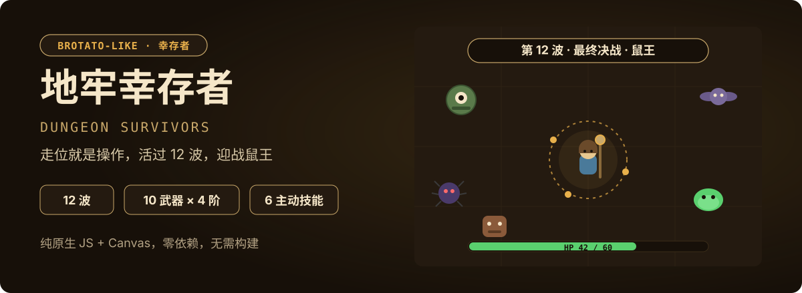
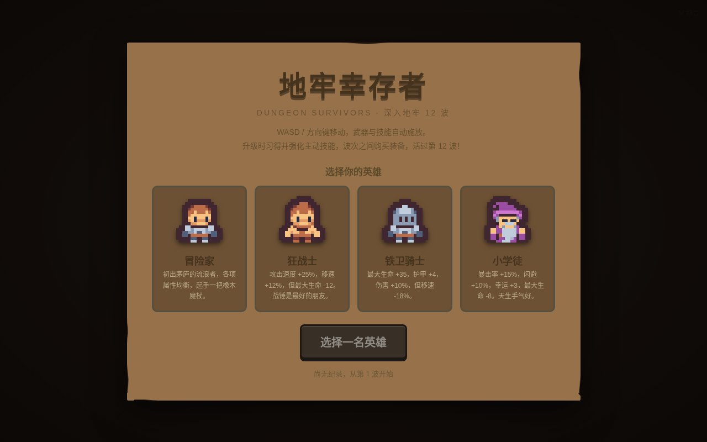
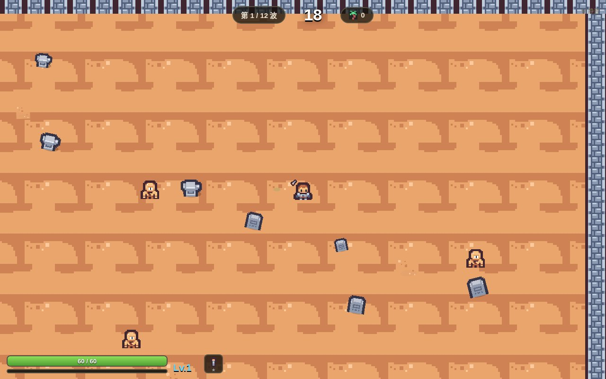

<p align="right"><a href="README.md">中文</a></p>

<p align="center">
  
</p>

<p align="center">
  <a href="https://holynova.github.io/last-spud/">▶ Play Online</a>
  ·
  <a href="https://github.com/holynova/last-spud">GitHub Repository</a>
</p>

Dungeon Survivors is a Brotato-like survivor game for the browser: pure vanilla JavaScript + Canvas, zero dependencies, no build step. Weapons and skills fire automatically — positioning is the gameplay. Survive 12 waves and face the final boss, the Rat King. Draft-one-of-four upgrades, a between-wave shop, weapon merging, auto-save, and a virtual joystick on mobile.

## Screenshots

<p align="center">
  
  
</p>

## How to Play

- **Move**: WASD / arrow keys (on mobile, drag on the left half of the screen for a virtual joystick). Weapons and skills fire on their own — positioning is the skill.
- **Goal**: survive **12 waves** (27–60 seconds each, starting at 27s for wave 1, +3s per wave). Wave 12 is the boss fight against the **Rat King** （鼠王， 1,600 HP, radial bullet patterns + charges).
- **Coins**: kills drop coins, which are both XP and currency.
- **Level up**: draft one of four — **stat boosts** (14 traits) / **learn a new skill** / **upgrade a skill**.
- **Skills**: carry up to 3 active skills (auto-cast), each upgradable to level 5.
- **Shop**: restocks after every wave — weapons (merge two of the same name and tier to upgrade, up to 4 tiers: 普通 Common / 精良 Fine / 稀有 Rare / 史诗 Epic), 14 passive items, a healing fountain, and rerolls. Items can be **🔒 locked** to survive rerolls.
- **Auto-save**: progress saves automatically at the start of each wave; the main menu offers **▶ 继续上局** ("Continue") to resume from the current wave. The save clears on death or victory.
- **Pause**: Esc / P to see all stats and skills; **M** to mute; switching tabs auto-pauses.
- **Stability**: the main loop self-recovers from errors (without interrupting the game), and a watchdog restarts it if it stops responding.

## Weapons (10 Types × 4 Tiers, Carry Up to 6)

| Weapon | Type | Trait |
| :--- | :--- | :--- |
| 橡木魔杖 (Oak Wand) | Single-shot | Steady fire rate, a beginner's starter |
| 毒藤魔杖 (Vine Wand) | Rapid-fire | Extremely fast venom-thorn bursts |
| 碎石战斧 (Rubble Axe) | Scatter | Shatters into 5 stone shards at close range |
| 符文长剑 (Rune Sword) | Piercing | Rune slash that pierces 3 enemies |
| 飞刀 (Throwing Knives) | Thrown | Thrown, piercing 2 enemies |
| 回旋飞斧 (Boomerang Axe) | Returning | Flies out and back to your hand, two hits |
| 战锤 (War Hammer) | Melee arc | Wide sweeping arc, massive knockback |
| 冰霜射线 (Frost Beam) | Laser | Pierces every enemy in a straight line |
| 风暴图腾 (Storm Totem) | Aura | Periodic lightning zapping all nearby enemies |
| 喷火魔杖 (Flame Wand) | Barrage | Short-range flame spray, a wall of fire |

Two of the same name and tier merge into the next tier; each tier adds +55% damage, −6% cooldown, +7% range.

## Skills (6)

| Skill | Effect |
| :--- | :--- |
| 震荡波 (Shockwave) | Periodic shockwave, damaging and knocking back nearby enemies |
| 闪电链 (Chain Lightning) | Lightning strikes the nearest enemy and chains through the crowd (upgrades add jumps) |
| 烈火结界 (Fire Field) | A ring of fire burning beneath your feet |
| 圣盾术 (Barrier) | Periodically grants a shield that absorbs damage first |
| 狂化 (Frenzy) | Greatly boosts attack speed and move speed for a short time |
| 荆棘领域 (Thorns) | Thorns around you deal damage and slow enemies over time |

## Characters

| Character | Traits | Starting Weapon |
| :--- | :--- | :--- |
| 冒险家 (Adventurer) | Balanced | 橡木魔杖 (Oak Wand) |
| 狂战士 (Berserker) | Attack speed +25%, move speed +12%, HP −12 | 战锤 (War Hammer) |
| 铁卫骑士 (Iron Guard Knight) | HP +35, armor +4, damage +10%, move speed −18% | 战锤 (War Hammer) |
| 小学徒 (Apprentice) | Crit +15%, dodge +10%, luck +3, HP −8 | 回旋飞斧 (Boomerang Axe) |

## Enemies

独眼怪 (One-Eyed Monster), 疾风蝠 (Swift Bat), 毒蛛 (Venom Spider, ranged), 爆爆蟹 (Boom Crab, explodes), 怨灵 (Wraith, tank), 分裂史莱姆 (Splitting Slime, splits into small slimes on death), 血祭司 (Blood Priest, elite), and the final boss **Rat King** （鼠王， radial bullet patterns + charges). Enemy HP and damage scale with waves (HP +42% per wave, plus an extra +25% per wave after wave 8).

## Run Locally

Zero build, zero dependencies — open it directly or serve it:

```bash
npm start
# Serves via python3 -m http.server 8377; open http://localhost:8377
# Or just double-click index.html
```

Tests (Node ≥ 18, headless, runs the real game logic):

```bash
npm test
# test/smoke.js (smoke: shop locking, save-and-continue, death settlement) +
# test/stress.js (stress: a full 12-wave clear), both verified passing
```

## Tech

- Pure vanilla JS + Canvas, zero runtime dependencies; art from [Kenney](https://kenney.nl) (CC0): tiny-dungeon / micro-roguelike / ui-pack-rpg-expansion, picked and assembled into `assets/` by `tools/build_assets.py`.
- All tuning lives in one file, `js/data.js` (weapons / skills / enemies / items / characters / wave curve) — balance changes touch only that file.
- Web Audio synthesized sound effects (no audio files); self-healing main loop with watchdog.

```
index.html            Entry and UI skeleton
css/style.css         Styles (parchment panels / pixel icons)
assets/               Kenney CC0 art (generated by tools/build_assets.py)
js/data.js            All tuning (weapons/skills/enemies/items/characters/wave curve)
js/weapons.js         Weapon firing and damage resolution
js/skills.js          Skill casting logic
js/entities.js        Player/enemies/bullets/drops/particles
js/game.js            State machine, spawn director, rendering
js/ui.js              DOM UI (HUD/upgrades/shop/results)
js/main.js            Canvas, input, main loop
js/audio.js           Web Audio synthesized sound effects
test/smoke.js         Headless smoke tests
test/stress.js        12-wave clear stress test
docs/ARCHITECTURE.md  Architecture analysis and refactor roadmap
docs/OPTIMIZATION.md  Optimization and feature-extension checklist
```
