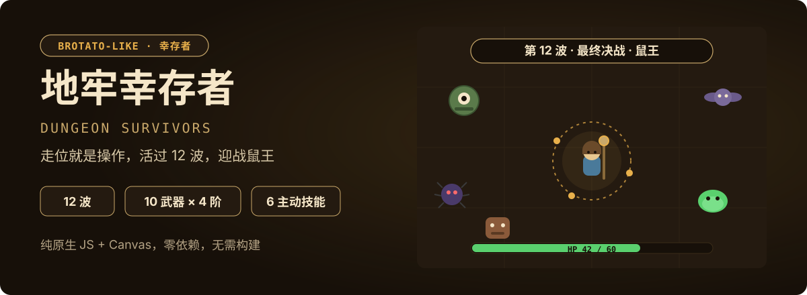
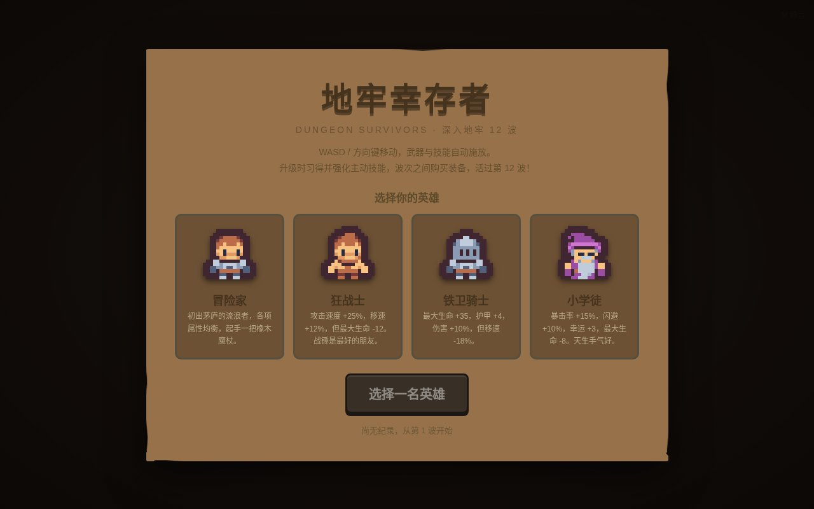
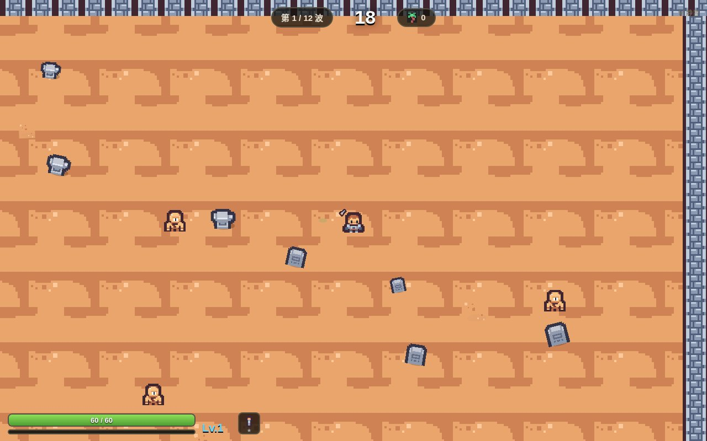

<p align="center">
  
</p>

<p align="center">
  <a href="https://holynova.github.io/last-spud/">▶ 在线玩 Play Online</a>
  ·
  <a href="https://github.com/holynova/last-spud">GitHub 仓库</a>
</p>

地牢幸存者是一款类《土豆兄弟》（Brotato）的网页幸存者游戏：纯原生 JavaScript + Canvas，零依赖，无需构建。武器与技能自动施放，你只管走位——活过 12 波，迎战最终 Boss 鼠王。升级四选一、波间商店、武器合成升阶、自动存档，手机端有虚拟摇杆。

Dungeon Survivors is a Brotato-like survivor game for the browser: pure vanilla JavaScript + Canvas, zero dependencies, no build step. Weapons and skills fire automatically — positioning is the gameplay. Survive 12 waves and face the final boss, the Rat King. Draft-one-of-four upgrades, a between-wave shop, weapon merging, auto-save, and a virtual joystick on mobile.

## 截图 / Screenshots

<p align="center">
  
  
</p>

## 玩法 / How to Play

- **移动**：WASD / 方向键（手机端左半屏拖动出现虚拟摇杆）；武器与技能自动施放，走位就是操作。
- **目标**：活过 **12 波**（每波 27~60 秒，第 1 波 27 秒起，每波 +3 秒），第 12 波迎战 Boss **鼠王**（1600 HP，环形弹幕 + 冲锋）。
- **材料**：击杀敌人掉落金币，既是经验也是金钱。
- **升级**：升级时四选一——**属性强化**（14 种词条）/ **习得新技能** / **技能升级**。
- **技能**：最多携带 3 个主动技能（自动施放），每个可升到 5 级。
- **商店**：每波结束后补货——武器（同名同阶合成升阶，最高 4 阶：普通 / 精良 / 稀有 / 史诗）、14 种被动道具、治疗泉水、重抽；商品可 **🔒 锁定**，重抽时保留。
- **自动存档**：每波开始自动保存进度，主菜单可 **▶ 继续上局**（从当前波恢复）；死亡或通关后清除。
- **暂停**：Esc / P 查看全部属性与技能；**M** 静音；切出窗口自动暂停。
- **稳定性**：主循环异常自动恢复（不中断游戏），看门狗检测循环失响应并重启。

## 武器（10 种 × 4 阶，最多携带 6 把）/ Weapons

| 武器 | 类型 | 特点 |
| :--- | :--- | :--- |
| 橡木魔杖 | 单发 | 射速稳定，新手起手 |
| 毒藤魔杖 | 连发 | 射速极快的毒刺连发 |
| 碎石战斧 | 散射 | 近身一击崩出 5 枚碎石 |
| 符文长剑 | 穿透 | 贯穿 3 人的符文剑气 |
| 飞刀 | 投掷 | 掷出并穿透 2 个敌人 |
| 回旋飞斧 | 回旋 | 掷出后飞回手中，两段伤害 |
| 战锤 | 近战扇形 | 扇形横扫，击退极强 |
| 冰霜射线 | 激光 | 贯穿一条直线上的所有敌人 |
| 风暴图腾 | 光环 | 周期电击周身所有敌人 |
| 喷火魔杖 | 弹幕 | 短程火焰喷射，弹幕成片 |

同名同阶两把可合成升阶；升阶伤害 +55%/阶、冷却 -6%/阶、射程 +7%/阶。

## 技能（6 种）/ Skills

| 技能 | 效果 |
| :--- | :--- |
| 震荡波 | 周期冲击波，伤害并击退周围敌人 |
| 闪电链 | 雷击最近敌人并在敌群间连锁跳跃（升级 +跳跃次数） |
| 烈火结界 | 脚下生成持续燃烧的火圈 |
| 圣盾术 | 周期获得护盾，优先抵挡伤害 |
| 狂化 | 短时间攻速/移速大幅提升 |
| 荆棘领域 | 周身荆棘持续伤害并减速 |

## 角色 / Characters

| 角色 | 特点 | 起始武器 |
| :--- | :--- | :--- |
| 冒险家 | 均衡 | 橡木魔杖 |
| 狂战士 | 攻速 +25%、移速 +12%，生命 -12 | 战锤 |
| 铁卫骑士 | 生命 +35、护甲 +4、伤害 +10%，移速 -18% | 战锤 |
| 小学徒 | 暴击 +15%、闪避 +10%、幸运 +3，生命 -8 | 回旋飞斧 |

## 敌人 / Enemies

独眼怪、疾风蝠、毒蛛（远程）、爆爆蟹（自爆）、怨灵（坦克）、分裂史莱姆（死后分裂成小史莱姆）、血祭司（精英），以及最终 Boss **鼠王**（环形弹幕 + 冲锋）。敌人血量与伤害随波次成长（血量每波 +42%，8 波后额外 +25%/波）。

## 本地运行 / Run Locally

零构建，零依赖，直接打开或起静态服务器：

```bash
npm start
# 即 python3 -m http.server 8377，打开 http://localhost:8377
# 直接双击 index.html 也可以玩
```

测试（Node ≥ 18，无头跑真实游戏逻辑）：

```bash
npm test
# test/smoke.js（冒烟：商店锁定、存档续玩、死亡结算）+
# test/stress.js（压力：完整跑通 12 波并通关），均已实测通过
```

## 技术 / Tech

- 纯原生 JS + Canvas，零运行时依赖；美术素材来自 [Kenney](https://kenney.nl)（CC0）：tiny-dungeon / micro-roguelike / ui-pack-rpg-expansion，由 `tools/build_assets.py` 挑选并组装进 `assets/`。
- 全部数值配置集中在 `js/data.js`（武器 / 技能 / 敌人 / 道具 / 角色 / 波次曲线），调平衡只改这一个文件。
- WebAudio 合成音效（无音频文件）；主循环异常自恢复 + 看门狗。

```
index.html            入口与 UI 骨架
css/style.css         样式（羊皮纸面板 / 像素图标）
assets/               Kenney CC0 素材（tools/build_assets.py 生成）
js/data.js            全部数值配置（武器/技能/敌人/道具/角色/波次曲线）
js/weapons.js         武器开火与伤害结算
js/skills.js          技能施放逻辑
js/entities.js        玩家/敌人/子弹/掉落/粒子
js/game.js            状态机、刷怪导演、渲染
js/ui.js              DOM UI（HUD/升级/商店/结算）
js/main.js            画布、输入、主循环
js/audio.js           WebAudio 合成音效
test/smoke.js         无头冒烟测试
test/stress.js        12 波通关压力测试
docs/ARCHITECTURE.md  架构分析与重构路线
docs/OPTIMIZATION.md  优化与功能扩展清单
```

## English

**Dungeon Survivors** is a Brotato-like survivor game for the browser: pure vanilla JavaScript + Canvas, zero dependencies, no build step. Weapons and skills fire on their own — your job is positioning. Survive 12 waves and beat the Rat King.

- **12 waves** (27–60s each, +3s per wave); wave 12 is the boss fight against the **Rat King** (1,600 HP, radial bullet patterns + charges).
- **10 weapons × 4 tiers** (common/fine/rare/epic, merge two of a kind to upgrade; carry up to 6): wand, vine wand, scatter axe, piercing rune sword, throwing knives, boomerang axe, hammer, frost beam, storm totem, flame wand.
- **6 auto-cast skills** (carry up to 3, each to level 5): shockwave, chain lightning, fire field, barrier, frenzy, thorns. Level-ups offer draft-one-of-four: stat boosts (14 traits), new skills, or skill upgrades.
- **Shop between waves**: weapons, 14 passive items, healing fountain, rerolls — and you can **lock** items to keep them through rerolls. Coins are both XP and currency.
- **4 characters** with distinct modifiers (balanced Adventurer, fast-but-fragile Berserker, tanky Knight, lucky Apprentice); **8 enemy types** plus the boss; auto-save at each wave start with continue-from-wave; pause (Esc/P), mute (M), auto-pause on tab switch; virtual joystick on mobile.
- **Run it**: `npm start` (port 8377) or just open `index.html`. **Tests**: `npm test` — headless smoke + a full 12-wave clear stress test, both verified passing.
- **Tech**: vanilla JS + Canvas; art from Kenney (CC0); all tuning lives in `js/data.js`; Web Audio synthesized SFX; self-healing main loop with watchdog.

## 许可 / License

MIT 协议（`package.json` 声明；仓库内暂无 LICENSE 文件）。美术素材为 Kenney CC0。
